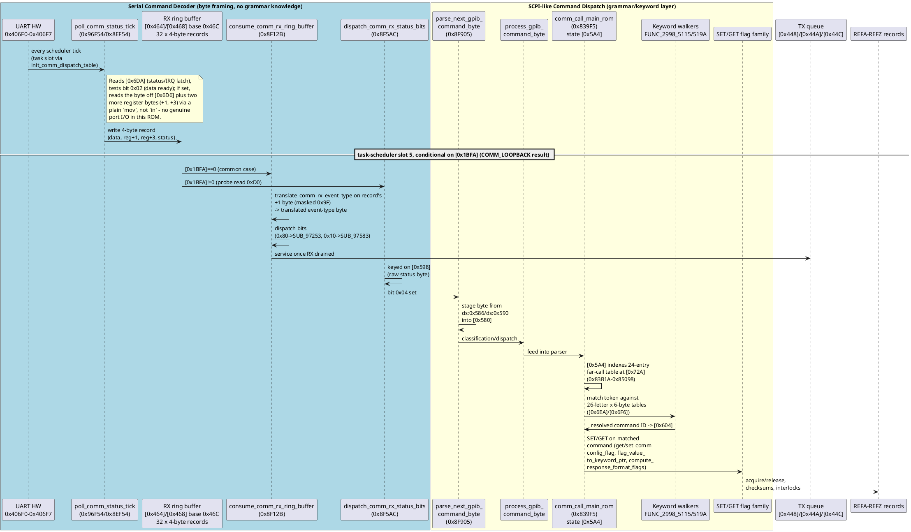
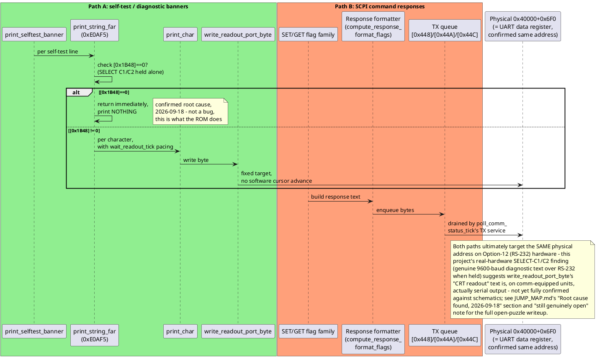
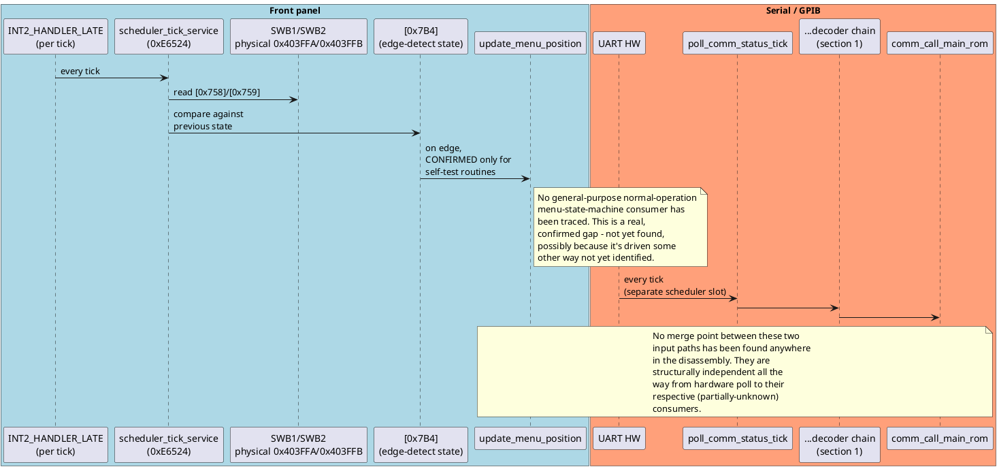
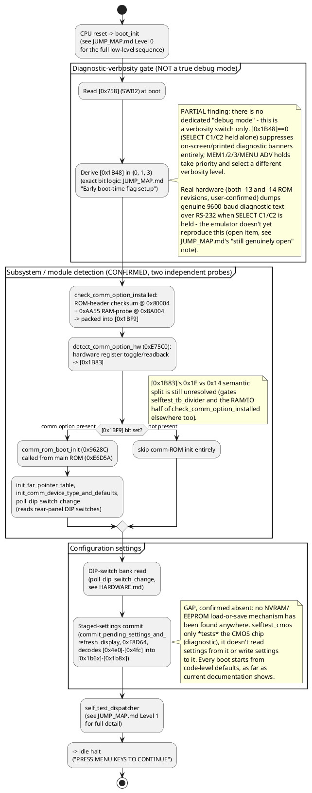

# Subsystem object model: boot, input, comm dispatch, and display

A top-down pass tying together findings that were previously scattered
across many single-topic files. This is a *synthesis* document — it
doesn't introduce new disassembly findings, it draws the object-model
boundaries between subsystems already documented elsewhere and asks,
for each one, "where do its inputs come from, and where does its
output go." Citations point back to the files that did the primary
research; this file is the map, not the territory.

Two things this pass deliberately does, per the request that prompted
it: (1) draws a hard line between the comm ROM's **byte-level serial
decoder** (UART framing, ring buffers) and its **SCPI-like command
dispatch layer** (keyword/grammar parsing) — these are two different
subsystems that happen to live in the same ROM and are easy to
conflate; (2) states plainly, where current documentation has nothing,
that nothing exists yet — rather than guessing. See "Confirmed gaps"
at the end for the full list.

## Object model: major subsystems and their relationships

```plantuml
@startuml
skinparam componentStyle rectangle

package "Boot / Init" {
  [boot_init / finish_boot_init_and_start_scheduler]
  [Module detection\n(check_comm_option_installed,\ndetect_comm_option_hw)]
  [Config load\n(poll_dip_switch_change)]
}

package "Task Scheduler" {
  [switch_to_next_task\n(12-slot tick table)]
}

package "Front-Panel Input" {
  [scheduler_tick_service\n(SWB1/SWB2 poll + edge-detect)]
}

package "Serial Command Decoder" {
  [UART registers\n(0x406F0-0x406F7)]
  [poll_comm_status_tick\n(RX producer)]
  [RX ring buffer\n([0x464]/[0x468], 32x4B]
  [TX queue\n([0x448]/[0x44A]/[0x44C]]
  [consume_comm_rx_ring_buffer / dispatch_comm_rx_status_bits\n(RX consumers)]
  [parse_next_gpib_command_byte]
}

package "SCPI-like Command Dispatch" {
  [comm_call_main_rom\n(lexer/parser, [0x5A4] state)]
  [Keyword-table walkers\n(FUNC_2998_5115/519A)]
  [SET/GET flag family\n(get/set_comm_config_flag, ...)]
  [REFA-REFZ reference-\nmemory records]
}

package "Self-Test / Diagnostics" {
  [self_test_dispatcher]
  [print_selftest_banner]
}

package "Menu / Item-List Engine" {
  [[0x1D10] handler table\n(render_item_list_row, ...)]
}

package "Acquisition & Plotting" {
  [handle_acq_mode_change]
  [Number formatter\n(snapshot_index_and_format_number)]
}

package "Display" {
  [CRT readout text memory\n(0x40000-0x4FFFF)]
  [write_readout_port_byte]
  [Vector display list\n(0x02200, stroke font)]
}

package "Configuration" {
  [Staged settings commit\n(commit_pending_settings_and_refresh_display)]
}

package "NVRAM / Persistence" {
  [??? -- GAP, nothing found]
}

[boot_init / finish_boot_init_and_start_scheduler] --> [switch_to_next_task\n(12-slot tick table)]
[boot_init / finish_boot_init_and_start_scheduler] --> [Module detection\n(check_comm_option_installed,\ndetect_comm_option_hw)]
[Module detection\n(check_comm_option_installed,\ndetect_comm_option_hw)] --> [Config load\n(poll_dip_switch_change)]
[Config load\n(poll_dip_switch_change)] ..> [??? -- GAP, nothing found] : no load from\nnon-volatile store

[switch_to_next_task\n(12-slot tick table)] --> [scheduler_tick_service\n(SWB1/SWB2 poll + edge-detect)]
[switch_to_next_task\n(12-slot tick table)] --> [poll_comm_status_tick\n(RX producer)]

[UART registers\n(0x406F0-0x406F7)] --> [poll_comm_status_tick\n(RX producer)]
[poll_comm_status_tick\n(RX producer)] --> [RX ring buffer\n([0x464]/[0x468], 32x4B]
[RX ring buffer\n([0x464]/[0x468], 32x4B] --> [consume_comm_rx_ring_buffer / dispatch_comm_rx_status_bits\n(RX consumers)]
[consume_comm_rx_ring_buffer / dispatch_comm_rx_status_bits\n(RX consumers)] --> [parse_next_gpib_command_byte]
[consume_comm_rx_ring_buffer / dispatch_comm_rx_status_bits\n(RX consumers)] --> [TX queue\n([0x448]/[0x44A]/[0x44C]]
[TX queue\n([0x448]/[0x44A]/[0x44C]] --> [UART registers\n(0x406F0-0x406F7)]

[parse_next_gpib_command_byte] --> [comm_call_main_rom\n(lexer/parser, [0x5A4] state)]
[comm_call_main_rom\n(lexer/parser, [0x5A4] state)] --> [Keyword-table walkers\n(FUNC_2998_5115/519A)]
[comm_call_main_rom\n(lexer/parser, [0x5A4] state)] --> [SET/GET flag family\n(get/set_comm_config_flag, ...)]
[SET/GET flag family\n(get/set_comm_config_flag, ...)] --> [REFA-REFZ reference-\nmemory records]
[comm_call_main_rom\n(lexer/parser, [0x5A4] state)] --> [handle_acq_mode_change]

[scheduler_tick_service\n(SWB1/SWB2 poll + edge-detect)] --> [[0x1D10] handler table\n(render_item_list_row, ...)] : self-test only,\nconfirmed
[[0x1D10] handler table\n(render_item_list_row, ...)] --> [handle_acq_mode_change]
[handle_acq_mode_change] --> [Number formatter\n(snapshot_index_and_format_number)]
[Number formatter\n(snapshot_index_and_format_number)] --> [CRT readout text memory\n(0x40000-0x4FFFF)]

[self_test_dispatcher] --> [print_selftest_banner]
[print_selftest_banner] --> [write_readout_port_byte]
[write_readout_port_byte] --> [CRT readout text memory\n(0x40000-0x4FFFF)]
[write_readout_port_byte] .right.> [UART registers\n(0x406F0-0x406F7)] : same physical\naddress on\nOption-12 hw (!)

[self_test_dispatcher] ..> [UART registers\n(0x406F0-0x406F7)] : COMM_LOOPBACK probe

[[0x1D10] handler table\n(render_item_list_row, ...)] --> [Staged settings commit\n(commit_pending_settings_and_refresh_display)]
[Staged settings commit\n(commit_pending_settings_and_refresh_display)] ..> [??? -- GAP, nothing found] : no save to\nnon-volatile store

note bottom of [Vector display list\n(0x02200, stroke font)]
  Producer chain exists (print_readout_string ->
  draw_readout_char -> plot_readout_point_relative ->
  plot_readout_point) but the hardware CONSUMER that
  draws this list to the CRT has never been found.
  Also: draw_readout_char is gated by [0x1B83] and
  returns immediately without drawing on both of this
  project's physical test units (Option-12/RS-232
  equipped), so this path is practically dead on the
  hardware actually tested against.
end note

note bottom of [??? -- GAP, nothing found]
  Confirmed absent, not merely undocumented:
  no page-flip/bank-switch/double-buffer display
  mechanism, and no NVRAM/EEPROM settings-persistence
  mechanism, exist anywhere in current docs.
  selftest_cmos is diagnostic-only (tests the CMOS
  chip), not a load/save path.
end note
@enduml
```

## 1. Serial command decoder vs. SCPI-like command dispatch

This is the split the rest of the project's docs had implicitly made
but never drawn explicitly. They are genuinely two different jobs,
done by different code, with a clean handoff point
(`parse_next_gpib_command_byte` → `process_gpib_command_byte`):

- **Serial command decoder** — owns UART framing and buffering only.
  It knows nothing about command grammar; it just gets bytes off the
  wire (or queues them to go back out) reliably. See
  `docs/comm-rom/rs232-flow-control-and-open-puzzle.md`.
- **SCPI-like command dispatch** — owns command *meaning*: lexing a
  command line into tokens, matching tokens against keyword tables,
  validating/applying arguments, and formatting responses. It never
  touches the UART registers directly. See
  `docs/comm-rom/command-parser-token-scan-and-plot-handler.md` and
  `VARIABLES.md`'s "Comm ROM" section (lines ~178-217).



**Key point this makes explicit**: the "12-slot scheduler table"
feeding the serial decoder and the "24-entry far-call jump table"
feeding the SCPI dispatcher are two *different* tables at two
different addresses, serving two different purposes, and it would be
easy (this project already made exactly this mistake once — see
`changes/2026-10-14.md`'s "duplicate rediscovery" correction) to
conflate a slot in one with an entry in the other. Keep them visually
and conceptually distinct.

## 2. Text/status output generation

Two genuinely separate output paths exist, and — per the earlier
`JUMP_MAP.md` "Root cause found, 2026-09-18" finding — they may
collide at the hardware level on comm-option-equipped units:



The decimal/unit-suffix **number formatter**
(`snapshot_index_and_format_number`, shared `SUB_F5184`/`L_F50FA`
digit loop) feeds Path A — it's how menu-item values like "1.23mV" or
"500ns" get turned into the character stream that
`copy_char_cell_template_and_sync` lays into print records before
`print_char` ever runs. See
`docs/acquisition-and-plotting/mode-dispatcher-and-formatting.md`.

## 3. Serial FIFO buffers

| Buffer | Pointers | Base | Size/shape | Direction | Notes |
|---|---|---|---|---|---|
| RX ring buffer | `[0x464]` (write) / `[0x468]` (read) | `0x46C` | 32 × 4-byte records (`0x80` bytes) | UART → firmware | Records: data byte, reg+1, reg+3, status byte. Correct wraparound confirmed. |
| TX queue | `[0x448]`/`[0x44A]`/`[0x44C]` | `0xAF`-sized | 1-byte records | firmware → UART | Simpler than RX — no per-byte status needed for outgoing data. Serviced by `consume_comm_rx_ring_buffer` once RX is drained. |

**Documentation gap, closed 2026-10-14**: neither buffer previously had
a row in `VARIABLES.md`'s "Comm ROM" table — `[0x464]` only existed
there under its unrelated main-ROM meaning (the `[0x1D10]` menu-item
index), with a stale "not reconciled" caveat. Both buffers now have
their own rows there (`[0x464]`/`[0x466]`, `[0x468]`/`[0x46A]`,
`[0x448]`/`[0x44A]`/`[0x44C]`), and the main-ROM `[0x464]` entry's
caveat now points at them instead of just flagging the collision as
unresolved. This is a genuine same-address reuse across the two ROMs'
separate contexts, not an error.

## 4. CRT layout buffers and screen data paging

```plantuml
@startuml
left to right direction
rectangle "Vector display list\n(physical 0x02200, 0x1400 bytes)" as VDL {
  rectangle "(Y, attr, X, attr)\n4-byte entries,\nwraparound marker" as VDLfmt
}
rectangle "CRT readout text memory\n(physical 0x40000-0x4FFFF)" as TXT {
  rectangle "Dual-plane evidence\n(+0x8000 offset)\n-- inferred, NOT\nconfirmed char+attr" as TXTfmt
}

"print_readout_string" --> "draw_readout_char" --> "plot_readout_point_relative" --> "plot_readout_point" --> VDL
note right of VDL
  Consumer (what actually scans this
  list and paints it to the CRT) has
  never been found - open since the
  original stroke-font hunt.
  Also: draw_readout_char checks
  [0x1B83] and returns immediately
  WITHOUT drawing on both of this
  project's physical units (both are
  Option-12/RS-232 equipped) - this
  path is effectively dead code on
  real tested hardware, not just
  undocumented.
end note

"print_string_far" --> "print_char" --> "write_readout_port_byte" --> TXT
note right of TXT
  Fixed target address (0x40000+0x6F0),
  no software cursor advance. Call sites
  exclusively in self-test-report code.
  This address is confirmed identical to
  the real UART data register's physical
  address - see section 2 above.
end note
@enduml
```

**Screen data paging: confirmed absent.** An exhaustive grep of
`MEMORY_MAP.md`, `FUNCTIONS.md`, `VARIABLES.md`, and every
`docs/display/*` file turned up zero evidence of page-flipping,
bank-switching, or double-buffering for either buffer above. Every
"bank"/"page"/"flip" hit in the existing docs is unrelated: ACQ RAM
banks, front-panel switch banks, service-manual page numbers, and the
vector-icon Y-axis-flip rendering option. This is a genuine gap in
the firmware's documented behavior (or the mechanism genuinely doesn't
exist and the CRT is single-buffered/directly-scanned) — not a hint
that paging logic is waiting to be found with more digging.

Separately, the vector icons at `0xAE64`-`0xB061` are a *different*
buffer/table (different encoding) from the stroke-font display list
above — still unresolved whether they're icons or a rough font. See
`docs/display/vector-icons/README.md`.

## 5. User input: front panel vs. serial — confirmed separate paths



## 6. Boot-sequence branches: diagnostics, module detection, configuration



## Confirmed gaps (stated honestly, not guessed at)

These came up repeatedly while assembling this object model. Listing
them together so a future session doesn't have to re-derive "is this
actually missing, or did I just not find it":

1. **Screen data paging** — no page-flip/bank-switch/double-buffer
   mechanism for either CRT buffer exists anywhere in current
   documentation. See section 4.
2. **"Debug mode"** — doesn't exist as a distinct mode; what's real is
   a front-panel-gated diagnostic-*verbosity* switch (`[0x1B48]`). See
   section 6.
3. **Configuration persistence (NVRAM/EEPROM)** — no load/save
   mechanism found; settings appear to reset to code defaults every
   boot. See section 6.
4. **The vector display list's hardware consumer** — the code that
   *produces* stroke-font vector entries is well understood; nothing
   that reads the list back and draws it to the CRT has been found.
   Doubly moot on this project's own physical test hardware, where the
   producer itself is gated off. See section 4.
5. **Normal-operation front-panel menu consumer** — `update_menu_position`
   is confirmed only as a self-test consumer of `[0x758]`/`[0x759]`;
   no general-purpose menu-state-machine consumer for ordinary
   (non-self-test) operation has been traced. See section 5.
6. ~~Serial FIFO buffers lack `VARIABLES.md` entries~~ — **closed
   2026-10-14**: both buffers now have dedicated rows in `VARIABLES.md`'s
   "Comm ROM" table (section 3).

## See also

- `docs/comm-rom/rs232-flow-control-and-open-puzzle.md` — serial
  decoder detail, the `[0x1BFA]`-conditional task-slot-5 resolution
- `docs/comm-rom/command-parser-token-scan-and-plot-handler.md` — SCPI
  dispatch layer detail
- `docs/interrupts/task-scheduler.md` — the 12-slot tick table
- `docs/acquisition-and-plotting/mode-dispatcher-and-formatting.md` —
  number formatting, item-list handler cluster
- `docs/display/vector-display-and-stroke-font.md`,
  `docs/display/readout-memory.md` — CRT buffer detail
- `JUMP_MAP.md` — boot sequence, self-test dispatcher, the
  SELECT-C1/C2 open puzzle this file's section 2 depends on, and (as
  of 2026-10-14) its own control-flow-style companion diagrams for
  this file's sections 1 and 5 (the serial-decoder/SCPI-dispatch
  handoff, and the front-panel input poll path)
- `VARIABLES.md` lines ~178-217 — the comm-ROM RAM-structure table
  this file's sections 1 and 3 are drawn from
